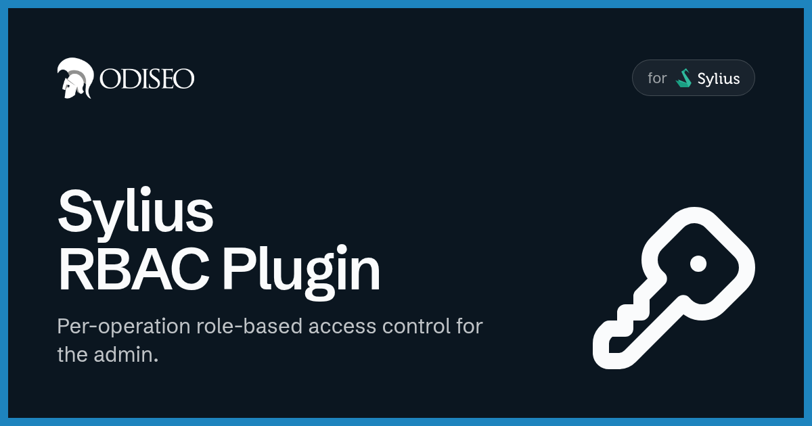
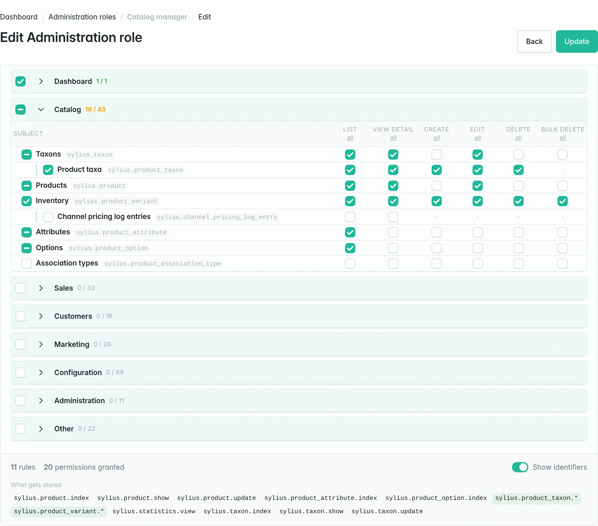
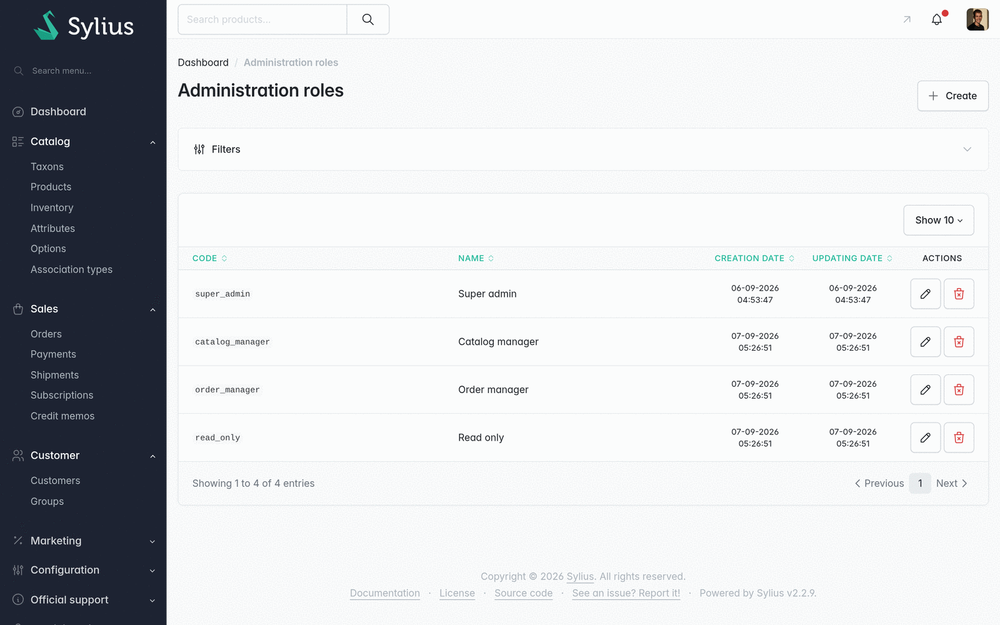
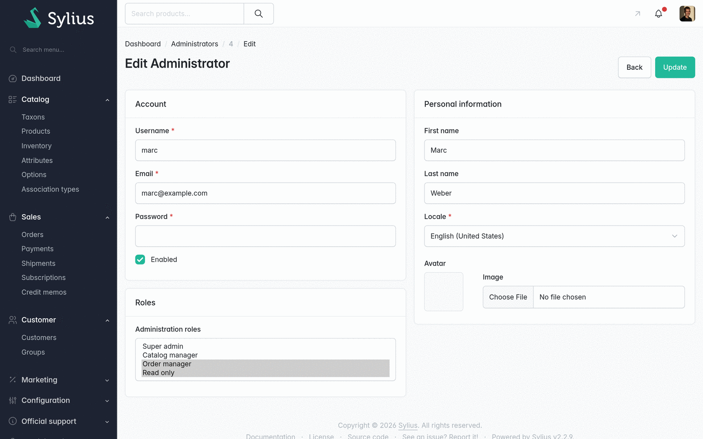
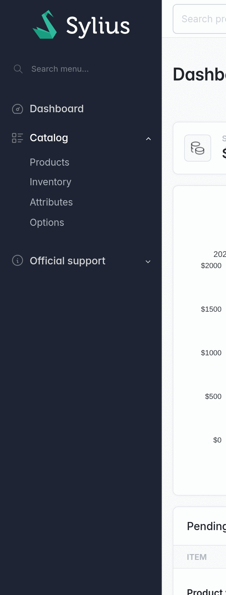
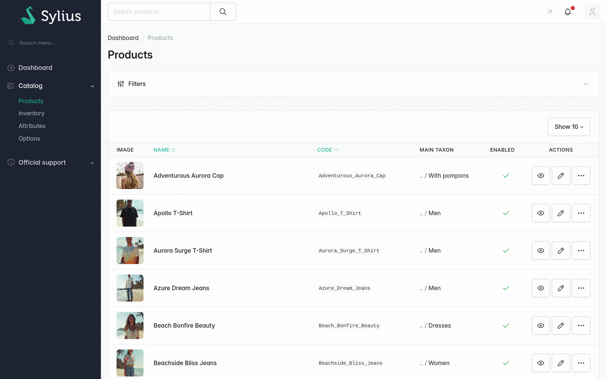

<p align="center">
    <a href="https://odiseo.io/en/products/sylius-plugins?utm_source=github&utm_medium=readme&utm_campaign=sylius-rbac-plugin" target="_blank">
        
    </a>
</p>
<p align="center">
    <a href="https://packagist.org/packages/odiseoteam/sylius-rbac-plugin"></a>
    <a href="https://packagist.org/packages/odiseoteam/sylius-rbac-plugin"></a>
    <a href="https://github.com/odiseoteam/SyliusRbacPlugin/actions/workflows/build.yaml"></a>
    
    
    <a href="LICENSE"></a>
</p>

## Introduction

This plugin adds role-based access control to the Sylius admin: you define your own roles, one permission per operation on one resource, and it enforces them everywhere.

### What makes this plugin different?

- ✅ **One permission per operation** - `sylius.product.update` and `sylius.product.delete` are separate permissions
- ✅ **Every admin route and API operation covered** - Permissions come from Sylius' own resource metadata, so routes added by other plugins are covered automatically
- ✅ **Deny by default** - An unprotected route is denied, not allowed. Exceptions are explicit, in config
- ✅ **UI filtered, not just routes** - Menu entries, grid buttons and dashboard widgets check the same permission
- ✅ **Workflow transitions included** - Cancelling an order asks for `sylius.order.cancel`, not `sylius.order.update`
- ✅ **Multiple roles per administrator** - Roles are additive, with a lockout guard on the roles screen
- ✅ **Console tooling** - Grant access, list permissions, find orphaned ones and migrate v2 data from the CLI
- ✅ **18 locales** - Including English, Spanish, French, German, Polish, Portuguese, Simplified Chinese and Arabic

<details open>
<summary>
 Screenshots
</summary> <br />

<p align="center">
    <a href="doc/managing-roles.md#editing-permissions">
        
    </a>
</p>

<table>
    <tr>
        <td width="50%" align="center">
            <a href="doc/managing-roles.md#the-roles-screen"></a>
            <br /><sub><b>Roles:</b> The ones you define, not a fixed list</sub>
        </td>
        <td width="50%" align="center">
            <a href="doc/managing-roles.md#assigning-roles"></a>
            <br /><sub><b>Assignment:</b> An administrator may hold several roles</sub>
        </td>
    </tr>
    <tr>
        <td width="50%" align="center">
            <a href="doc/enforcement.md#the-main-menu"></a>
            <br /><sub><b>Menu:</b> Trimmed to what the role can reach</sub>
        </td>
        <td width="50%" align="center">
            <a href="doc/enforcement.md#grid-actions"></a>
            <br /><sub><b>Grids:</b> No Create, no Delete, for a role without them</sub>
        </td>
    </tr>
</table>

</details>

## Getting Started

### Install it in 5 steps ⚡

1. ✅ Require the plugin
2. ✅ Wire the assets
3. ✅ Make your `AdminUser` administration-role aware
4. ✅ Update the database schema
5. ✅ Give someone access

**[👉 Follow the installation guide](doc/installation.md)**

### Quick Example

Require the plugin. Symfony Flex's recipe registers the bundle and imports its config and routes for you:

```bash
composer require odiseoteam/sylius-rbac-plugin --no-scripts
```

Once the remaining steps are done, grant the first role from the console:

```bash
bin/console odiseo:rbac:grant <username-or-email> super_admin --create
```

> [!IMPORTANT]
> An administrator with no role is denied everything, including the screen that assigns roles. Right after installing, nobody can reach the admin panel until you grant that first role.

## What a permission looks like

Every permission is `{package}.{subject}.{operation}`, the same code Sylius' own resource metadata produces:

| Pattern                 | Meaning                                        |
| ----------------------- | ---------------------------------------------- |
| `sylius.product.update` | One operation on one resource                  |
| `sylius.product.*`      | Everything on products                         |
| `sylius.order.ship`     | An operation that is not CRUD                  |
| `*.*.index`             | A read-only role, across the whole application |
| `*.*.*`                 | A super administrator                          |

A role stores the pattern as written, not the list of operations it matches today, so `sylius.product.*` keeps working when Sylius adds a new operation to products later.

**[Learn more about the permission model →](doc/permissions.md)**

## Documentation

- 📦 **[Installation](doc/installation.md)** - Three steps with Flex, plus the two the recipe cannot do
- 🔑 **[The permission model](doc/permissions.md)** - Identifiers, patterns, wildcards, how the tree is built
- 🛡️ **[What gets enforced](doc/enforcement.md)** - The six surfaces, and what happens to a route nobody covered
- 👥 **[Managing roles](doc/managing-roles.md)** - Day-to-day use of the admin screens
- ⚙️ **[Configuration reference](doc/configuration.md)** - Every key under `odiseo_sylius_rbac`
- 🧩 **[Extending](doc/extending.md)** - Declaring permissions for your own routes and plugins
- 💻 **[Console commands](doc/console.md)** - `grant`, `debug`, `migrate-permissions`
- 🚑 **[Troubleshooting](doc/troubleshooting.md)** - Locked out, unexpected 403, orphaned declarations
- ⬆️ **[Upgrading to 3.0](UPGRADE-3.0.md)** - What breaks, and how stored roles are migrated
- 🤝 **[Contributing](CONTRIBUTING.md)** - Running the test application and the suites

## Compatibility

| Plugin | Sylius          | PHP             | Symfony   | Database                     |
| ------ | --------------- | --------------- | --------- | ---------------------------- |
| `^3.0` | 2.0 · 2.1 · 2.2 | 8.2 · 8.3 · 8.4 | 6.4 · 7.x | MySQL · MariaDB · PostgreSQL |
| `^2.0` | 1.12 · 2.0      | 8.0+            | 5.4 · 6.x | MySQL · MariaDB              |

> [!NOTE]
> The schema migrations ship for MySQL/MariaDB and PostgreSQL. On any other engine they skip, and Doctrine records them as executed even so, so write your own before upgrading a 2.x database, see [Upgrading to 3.0](UPGRADE-3.0.md).

Only the latest minor is supported. Security fixes land on `master`.

## Professional Support

This plugin is maintained by [Odiseo](https://odiseo.io/en?utm_source=github&utm_medium=readme&utm_campaign=sylius-rbac-plugin). Need help with it, or with any Sylius project?

- 🎬 **[Live demo](https://odiseo.io/en/contact-us?utm_source=github&utm_medium=readme&utm_campaign=sylius-rbac-plugin)** - A live walkthrough of this plugin
- 🛠️ **[Sylius development](https://odiseo.io/en/contact-us?utm_source=github&utm_medium=readme&utm_campaign=sylius-rbac-plugin)** - Help with this plugin or any Sylius project
- 🏪 **[Multi-vendor marketplace](https://odiseo.io/en/products/sylius-marketplace-plugin?utm_source=github&utm_medium=readme&utm_campaign=sylius-rbac-plugin)** - Vendor role separation is one of the things a marketplace has to get right, and this plugin is how we do it
- 🔌 **[More Sylius plugins](https://odiseo.io/en/products/sylius-plugins?utm_source=github&utm_medium=readme&utm_campaign=sylius-rbac-plugin)** - Browse all our Sylius plugins

## License

[MIT](LICENSE).
